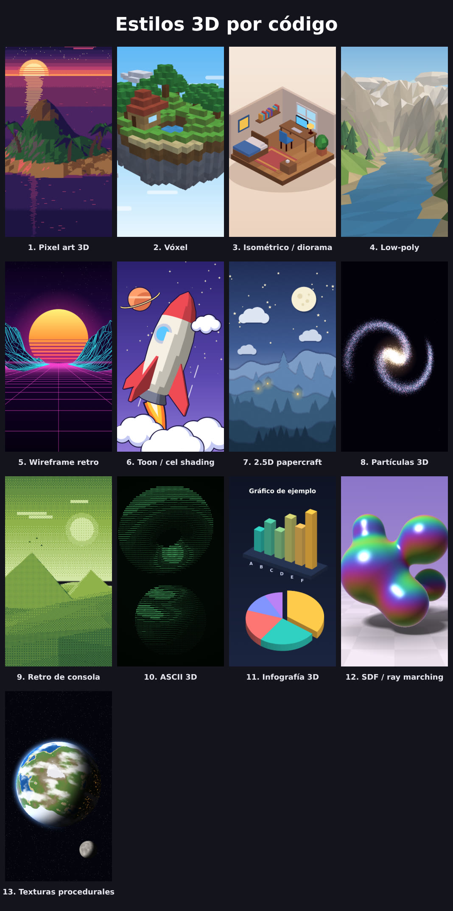

# Kit de animaciones 3D por código

Carpeta autónoma para añadir a **cualquier proyecto**: 13 estilos animados (Canvas 2D en Chromium) y animales 3D por SDF / ray marching (Node en CPU). Todo es código, sin GPU, sin imágenes ni modelos externos. El vídeo sale vertical a 1080×1920 y 30 fps, con letrero final y audio opcionales.



## Instalación en un proyecto

```bash
cp -r kit-animaciones-3d /ruta/al/proyecto/
cd /ruta/al/proyecto && bash kit-animaciones-3d/instalar.sh
```

El instalador:
- copia la skill `animaciones-3d` a `.claude/skills/`;
- añade a `CLAUDE.md` la regla **«antes de decidir el tipo de animación, pregunta al usuario qué tipo quiere»**;
- comprueba que estén `node` (18 o superior), `ffmpeg` y Playwright con Chromium. Si falta Playwright: `npm i -D playwright && npx playwright install chromium`. Con un Chromium ya instalado basta `CHROME_PATH=/ruta/chromium`.

Con eso, cuando pidas una animación, Claude te preguntará primero la familia y luego el estilo, con el catálogo delante.

## Temas detallados (5 temas × 14 estilos)

`leon`, `planeta`, `ciudad`, `persona`, `oceano` (ballena jorobada y tiburón blanco en el fondo marino) `delfin` (delfín mular en el mismo fondo marino) y `trafico` (ciudad y autopista con atasco y gráficos de velocidad, de noche o de día con `--dia`; estilos lowpoly, info, toon, paper, pixel, dither, ascii y wire), modelados con máximo detalle, en cualquiera de los estilos `pixel voxel iso lowpoly wire toon paper galaxy dither ascii info realista clay fieltro`:

```bash
node kit-animaciones-3d/bin/tema.cjs ciudad toon salida/ciudad.png
node kit-animaciones-3d/bin/tema.cjs planeta realista salida/planeta.mp4 --seg 8 --w 540 --h 960
```

| Ruta | Qué es |
|---|---|
| `temas/<tema>/modelo.js` | Modelo y entorno (malla para motor3d) |
| `temas/<tema>/estilos.js` | Los 11 estilos de malla para ese tema |
| `temas/<tema>/realista.js` | Escena SDF con texturas procedurales (sombras suaves, oclusión) |
| `temas/persona/sdf_persona.js`, `cabeza.js` | Persona y cabeza esculpidas como volumen SDF |
| `temas/persona/mallador.js`, `voxeles.js` | Convierten el volumen en malla (*surface nets*) y en vóxeles → `temas/persona/generado/` (se crean solos la primera vez) |
| `temas/oceano/animales_hd.js` | Versión de alto detalle para `realista`: ballena con la boca abierta (barbas, lengua, bolsa de la garganta con pliegues) y tiburón con la boca abierta (encías, dos filas de dientes, narinas, poros). Primeros planos: `TOMA=ballena` o `TOMA=tiburon` delante del comando |
| `temas/oceano/animales.js`, `mallador.js` | Ballena jorobada y tiburón blanco esculpidos como SDF; el mallador genera mallas y vóxeles en `temas/oceano/generado/` (solo, la primera vez, ~15 s) |
| `temas/<tema>/clay.js`, `temas/clay/` | **13 · Claymotion**: el tema en plastilina (bultos de modelado, huellas dactilares, vetas de color, luz de estudio). En vídeo va a 12 imágenes/s como el stop-motion y las huellas «hierven» un poco en cada imagen; `arcilla.js` es el material y `figuras.js` los personajes (león, ballena, tiburón, persona, cohete, palmera, acacia). **14 · Fieltro** usa las mismas escenas con material de lana afieltrada (fibras, pelusa en los bordes, sin brillo) |
| `bin/tema.cjs` | Fotograma o vídeo de cualquier tema y estilo |
| `catalogos/tema_*.jpg` | Hoja de los 12 estilos de cada tema (para enseñarla al preguntar) |
| `bin/fotograma_sdf.cjs` | Fotograma SDF con suavizado 2× repartido entre núcleos |

En vídeo, la cámara orbita despacio (`--orbita`, rad/s), el león camina, el planeta rota con el cohete en órbita, la gente de la ciudad avanza y en el océano nadan la ballena y el tiburón, se mecen las algas y se mueven las cáusticas.

## 15 · Muñecos (2.5D explicativo)
Personajes propios para vídeos explicativos, con acciones, planos de 3–6 s y transiciones: guía en [`munecos/README.md`](munecos/README.md), catálogo `catalogos/munecos.jpg`.

## Transiciones entre estilos

```bash
node kit-animaciones-3d/bin/transicion.cjs leon toon realista salida/leon.mp4 --seg 6 --cambio 3 --dur 1 --tipo pincel
node kit-animaciones-3d/bin/transicion.cjs a.mp4 b.mp4 salida/union.mp4 --cambio 4 --tipo circulo [--sincro]
```
Renderiza el tema en los dos estilos y pasa del uno al otro sin cortar el movimiento. Tipos: `fundido barrido cortina circulo pixeles radial disolver pincel`.
En el cambio se ve el mismo instante en los dos estilos; el encuadre coincide cuando los dos estilos usan la misma cámara (realista y la mayoría de los de malla; algunos, como pixel o iso, tienen su propia composición, y clay/fieltro su propio plató).

## Usar los clips en vídeos con voz
- **CREATOR IMAGINE**: componente `video` del timeline.
- **Video-imagen**: `VE.clip(esc, 'nombre', t, {...})` dentro de `escenas.js` (el MP4 en `proyectos/<tema>/clips/`), con subtítulos y grafismos encima.

## Temas nuevos
Los 5 temas son los que vienen hechos, no un límite: para cualquier otro tema se escribe su escena con las técnicas del estilo elegido (skill, paso 4). En plastilina y fieltro, `temas/clay/arcilla.js` (material) y `temas/clay/figuras.js` (personajes) se reutilizan: una escena nueva es un `temas/<tema>/clay.js` con `crearEscena({ escena, colores, camara })`.

## Uso directo

```bash
# Estilos (pixel voxel iso lowpoly wire toon paper galaxy dither ascii info sdf planet)
node kit-animaciones-3d/bin/estilo.cjs wire salida/stills --stills 0,2,4
node kit-animaciones-3d/bin/estilo.cjs wire salida/wire.mp4 --seg 8 --letrero @randonautico --letrero-s 5 --audio musica.wav

# Animales SDF (bosque, sabana o un fichero de escena propio)
node kit-animaciones-3d/bin/sdf.cjs sabana salida/stills --stills 0,3,6
node kit-animaciones-3d/bin/sdf.cjs sabana salida/sabana.mp4 --seg 10 --letrero @randonautico --letrero-s 7
```

| Opción | Qué hace |
|---|---|
| `--stills t1,t2` | Solo fotogramas PNG (mirarlos antes de renderizar) |
| `--seg`, `--fps` | Duración (por defecto 8 s en los estilos y 10 s en SDF) y fotogramas por segundo (30) |
| `--letrero @handle`, `--letrero-s` | Tarjeta «SIGUE A @handle» con fundido desde ese segundo |
| `--audio fichero` | Audio normalizado a −14 LUFS con entrada y salida suaves. El kit no compone música. |
| `--hilos` | Procesos en paralelo (por defecto, todos los núcleos) |
| `--extra a.js,b.js` | (estilos) carga escenas propias `ESC.nombre = (ctx, t) => {…}` |
| `--w`, `--h` | (SDF) resolución interna, por defecto 540×960, escalada con lanczos |

## Coste medido (contenedor de 4 CPU)

| Tipo | Por fotograma | 8–10 s de vídeo |
|---|---|---|
| Estilos ligeros (dither, iso, info, pixel, voxel, wire, ascii, lowpoly) | 0,05–0,1 s | menos de 1 min |
| toon, paper, galaxy, planet | 0,2–0,25 s | 1–2 min |
| Gotas SDF (`sdf`) | ~1,2 s | ~4 min |
| Animales SDF (`bosque`, `sabana`) a 540×960 | ~3–3,5 s | 15–20 min |

## Contenido

| Ruta | Qué es |
|---|---|
| `estilos/motor3d.js` | Mini motor 3D: cámara (perspectiva / ortográfica), caras con sombreado plano o toon, cajas, esferas, tornos, ruido, cuantizado de paleta |
| `estilos/escenasA.js`, `escenasB.js` | Las 13 demos animadas (`ESC.<estilo>(ctx, t)`) y `renderStyle(nombre, t)` |
| `sdf/motor.js` | Ray marching, cuadrúpedos paramétricos (ciervo, zorro, jirafa, cebra, guepardo) con marcha por cinemática inversa, sombras suaves, oclusión |
| `sdf/escenas/` | `bosque.js` (SDF) y `sabana.js` (texturas procedurales) |
| `bin/` | `estilo.cjs`, `sdf.cjs` y `comun.cjs` (letrero, audio, ffmpeg) |
| `claude/skills/animaciones-3d/SKILL.md` | Instrucciones para Claude: preguntar el tipo, generar y adaptar al tema |
| `CLAUDE_BLOQUE.md` | Bloque de reglas que el instalador añade a `CLAUDE.md` |

Notas:
- Las demos son ejemplos: para cada vídeo se escribe una escena propia con las técnicas del estilo. Cómo hacerlo está en la skill.
- En `info`, las barras y la tarta usan valores de ejemplo, no datos reales.
