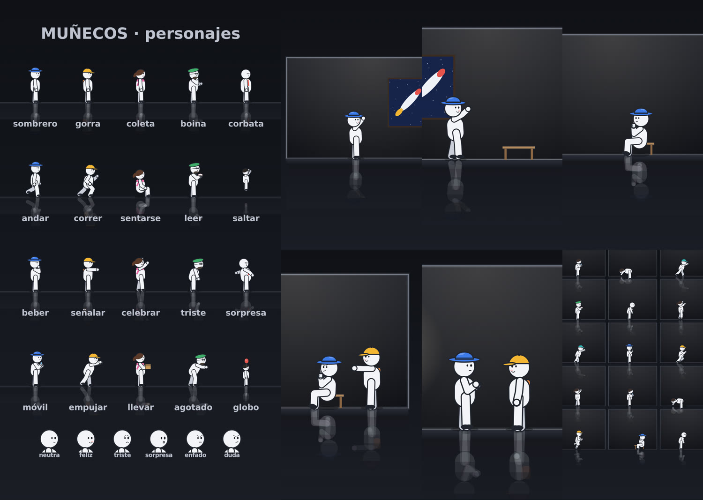

# 15 · Muñecos (2.5D explicativo)

Personajes propios del canal para vídeos explicativos: figuras blancas redondeadas, con ojos de punto, expresión y un **accesorio de color** que identifica a cada uno. No es 3D real: es dibujo 2D con profundidad simulada (sombra, reflejo en el suelo, luz de sala y cámara que se acerca, se aleja y atraviesa planos). Es rápido: segundos por fotograma.



**Los personajes y la cámara están hechos; el escenario, los objetos y la historia se crean para cada vídeo** según lo que cuente el guion.

## Personajes
```js
const ANA = MUN.persona({ color: 'azul', accesorio: 'sombrero' });
const LEO = MUN.persona({ color: 'amarillo', accesorio: 'gorra', mochila: 'naranja' });
```
| Opción | Valores |
|---|---|
| `color` | `azul amarillo rojo verde morado naranja rosa turquesa gris negro` o `#rrggbb` (color del accesorio) |
| `accesorio` | `sombrero gorra boina pelo coleta flequillo calvo` |
| extras | `gafas: true`, `barba: true`, `bufanda: 'rosa'`, `corbata: 'rojo'`, `mochila: 'naranja'`, `pelo: '#3a2e2a'` |
| tamaño | `altura: .66` (niño), `ancho: 1.15` (más corpulento) |
| `expresion` | `neutra feliz triste sorpresa enfado duda` (cambia también con `cara` en cada acción) |

## Acciones (se encadenan con transición suave)
```js
const a = MUN.actor(ANA, { x: -1.6, dir: 1, acciones: [
  { t: 0,   a: 'andar', hasta: -.3 },                     // se desplaza a su velocidad y al llegar queda quieto
  { t: 2.1, a: 'celebrar', cara: 'feliz' },
  { t: 4,   a: 'sentado', brazos: 'beber', objeto: 'taza' },   // postura + brazos de otra acción
]});
MUN.dibujar(ctx, a, t, { reflejo: .22 });                 // devuelve { mano, cabeza, … } para colocar cosas
```
Acciones: `quieto andar correr sentado (sentarse) saludar senalar senalarArriba celebrar pensar beber leer movil escribir contar triste agotado sorpresa encogerHombros empujar llevar llevarQuieto abrazar saltar caer dormir`.
Objetos en la mano: `taza movil libro maletin caja globo flor` o una función propia. `mira: -1|1` fuerza la orientación.

## Escenario básico (lo demás, según el vídeo)
`MUN.fondo`, `MUN.suelo` (brillante, con reflejos), `MUN.sala` (habitación en corte con borde de luz) y `MUN.props`: `banco silla mesa puerta cuadro planta lampara caja ventana`. Todo en unidades del mundo: 1 ≈ estatura de un muñeco, suelo en y = 0, y negativa hacia arriba. Para cada vídeo se dibujan los objetos que pida la historia (con las mismas reglas: formas limpias, contorno oscuro fino, sin filtros).

## Plan visual: planos dinámicos de 3–6 s
```js
const PLAN = MUN.plan([
  { dur: 4,   cam: { de: { x: -1.6, y: -.7, zoom: .6 }, a: { x: -.4, y: -.8, zoom: .85 } }, pinta: (ctx, tl, p) => { /* escena */ } },
  { dur: 4.5, entrada: 'zoom',    cam: { de: {…}, a: {…} }, pinta: … },
  { dur: 5,   entrada: 'barrido', cam: { … }, pinta: … },
]);
MUN.revisar(PLAN);                        // avisa si un plano no dura 3–6 s o si la cámara está quieta
MUN.pintar(ctx, 1080, 1920, PLAN, t);     // pinta el instante t con la cámara y la transición de entrada
```
- **Cada plano dura 3–6 s y la cámara siempre se mueve** (acercar, alejar, desplazar). `MUN.revisar` lo comprueba.
- Transiciones de entrada: `corte fundido zoom barrido deslizar`.
- **Un plano = una idea del guion**: lo que se ve cuenta lo que dice la voz en ese momento; los gestos entran en su palabra.
- Variar el tamaño de plano: general (sala entera), medio (uno o dos muñecos), detalle (cara, objeto) y, para cerrar o cambiar de idea, alejarse para mostrar el conjunto (varias salas o el mundo entero).
- Reservar el 21 % inferior de la pantalla a los subtítulos: el suelo y los reflejos pueden ir ahí; los gestos y objetos importantes, por encima.

## Uso
**Video-imagen** (sincronizado con la voz): `MUN` ya está cargado en el motor. En `escenas.js`, un plan por párrafo ajustado a su duración y gestos en la palabra:
```js
let p1;
(esc, t, ctx) => { p1 = p1 || MUN.ajustar([ { dur: 2, cam: {…}, pinta: (c, tl) => { …; MUN.dibujar(c, MUN.actor(ANA, { acciones: [{ t: 0, a: 'andar', hasta: 0 }, { t: ctx.palabra('consigues').ini, a: 'celebrar' }] }), tl, { reflejo: .22 }); } }, … ], ctx.dur);
  MUN.pintar(esc.ctx, esc.W, esc.H, p1, t); }
```
(`MUN.ajustar(planos, ctx.dur)` reparte la duración del párrafo manteniendo proporciones; `MUN.repartir(dur)` propone cuántos planos de 3–6 s caben.)

**Clip suelto** (CREATOR IMAGINE o cualquier proyecto): una escena `ESC.<nombre> = (ctx, t) => MUN.pintar(ctx, 1080, 1920, PLAN, t)` en un fichero propio y
```bash
node kit-animaciones-3d/bin/estilo.cjs <nombre> salida/stills --stills 0,4,8 --extra kit-animaciones-3d/munecos/munecos.js,mi_escena.js
node kit-animaciones-3d/bin/estilo.cjs <nombre> salida/clip.mp4 --seg 22 --fps 30 --extra kit-animaciones-3d/munecos/munecos.js,mi_escena.js
```
Demostración: `munecos/demo.js` (`munecos_fichas` y `munecos_demo`, 5 planos, 22 s).
